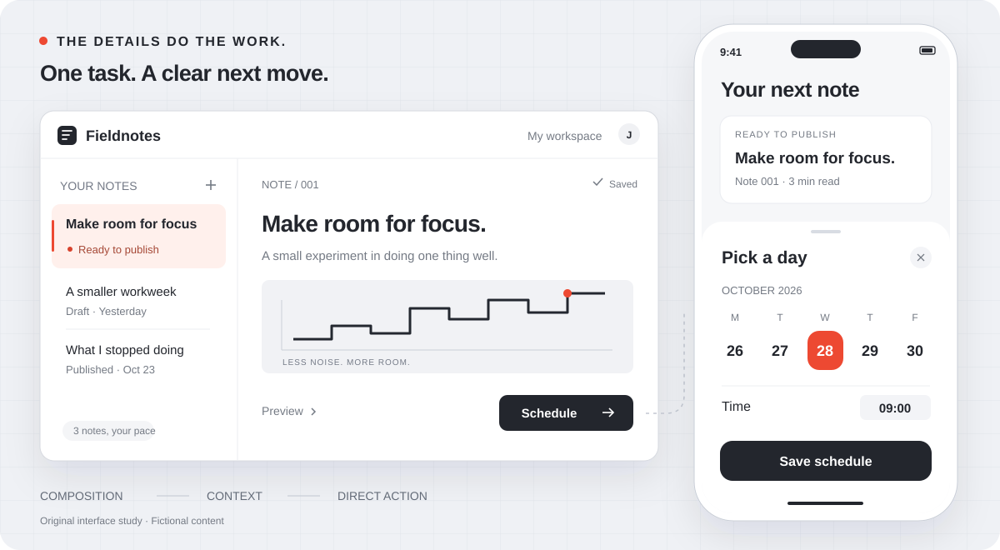

<p align="center">
  <picture>
    <source media="(prefers-color-scheme: dark)" srcset="docs/assets/wordmark-dark.svg" />
    
  </picture>
</p>

<h3 align="center">Give your agent an eye for design.</h3>

<p align="center">A design skill for websites and apps that look good and feel right.</p>

<p align="center">
  <a href="#start"><strong>Get started</strong></a> &nbsp;&nbsp;
  <a href="docs/installation.md">Choose your agent</a> &nbsp;&nbsp;
  <a href="https://clawhub.ai/theosunny/skills/ui-foundry">ClawHub</a> &nbsp;&nbsp;
  <a href="README.zh-CN.md">简体中文</a>
</p>

<p align="center">
  <picture>
    <source media="(max-width: 600px)" srcset="docs/assets/interface-study-mobile.svg" />
    
  </picture>
  <br/>
  <sub>Original interface study · Fictional content · An illustration of the design approach, not a shipped app.</sub>
</p>

**You shouldn't have to become a designer to get a well-designed product.**

Describe what people need to do. UI Foundry guides your coding agent through the design decisions: what to show, what to leave out, how it should feel, and how to check the result. You make the important calls; your agent handles the details.

<p align="center">
  <strong>Web · Product workspaces · Native apps</strong><br/>
  <sub>Open source · MIT-0 · No extra service or API key required by the skill</sub>
</p>

<a id="start"></a>

## Install once. Start with your idea.

```sh
npx skills add theosunny/ui-foundry -g
```

Choose **Codex, Claude Code, Cursor, OpenCode or OpenClaw** in the installer. Then ask:

> Use UI Foundry to make this product look and feel good. Decide the design details, make the main task easier, and check the actual result. Keep what already works.

That's enough to start. You can bring an idea, an existing screen, a repository or a rough sketch.

<details>
<summary>Installation details, other methods and invocation</summary>

The [Skills CLI](https://github.com/vercel-labs/skills) requires **Node.js 22.20+**. `-g` installs across projects; omit it for the current project. The skill itself needs no Node.js or Python setup.

In Codex, invoke **`$ui-foundry`** explicitly if needed. Other clients use their own skill picker or invocation format; reload the client if required.

[Specific agents & manual installation](docs/installation.md) · [ClawHub](https://clawhub.ai/theosunny/skills/ui-foundry) · [Download ZIP](https://github.com/theosunny/ui-foundry/releases)

</details>

## The details that make a difference

| A clear visual direction | Less effort to get things done | A review of the real result |
| --- | --- | --- |
| Composition, typography and states that belong together. A mobile app that behaves like one. | Reuse what's known. Put actions next to the content. Ask for information only when it's needed. | Inspect rendered screens and try the task. Fix observed problems, then check again. |

UI Foundry doesn't prescribe a palette or component library. It works with your project's direction, preserves useful writing and efficient forms, and checks visual quality separately from usability.

## Start wherever you are

| What you have | What to ask |
| --- | --- |
| **An idea** | “Design and build this iPhone app. You choose the direction.” |
| **A frustrating screen** | “I have to read and type too much here. Make the task easier.” |
| **A brief for another agent** | “Turn this idea into a complete design brief. Don't change code yet.” |
| **A result that missed** | “Find why this design failed, fix the cause and check the correction.” |

The workflow is simple: **understand the task → design → build → inspect → refine**. Reviews distinguish a checked result, a known defect and missing evidence. A successful build alone doesn't settle the design.

## Inside the skill

Design guidance, review references and a review-record template travel together. An optional helper lives at `ui-foundry/scripts/check_design_gate.py` inside the installed skill. Your agent resolves its location; **you don't need to run Python**. It checks record structure, not beauty or evidence quality.

[Read the skill](skills/ui-foundry/SKILL.md) · [Review workflow](skills/ui-foundry/references/review.md) · [Advanced helper usage](docs/review-records.md)

<details>
<summary>Language, verification and privacy</summary>

The READMEs are in English and Chinese. Internal skill instructions currently use Chinese; ask for output in your preferred language.

Installation checks don't establish identical behavior in every client. Browser checks don't certify native-app behavior. See the [behavior checks](docs/validation.md) and [installation checks](docs/installation-validation.md) for the actual scope. The interface study above is original illustrative artwork, not a measured before/after result.

UI Foundry guides and reviews design; it cannot guarantee a perfect result every time. Private profiles, chat history, credentials and personal product data are not bundled. It doesn't automatically upload project data or publish its own updates.

</details>

## Make it better

Found a failure? [Open an issue](https://github.com/theosunny/ui-foundry/issues) with a fictional or redacted example: your request, expected result, actual result and client. Useful feedback helps improve the workflow.

[MIT-0](LICENSE) · [Changelog](CHANGELOG.md) · [Acknowledgments](ACKNOWLEDGMENTS.md)
