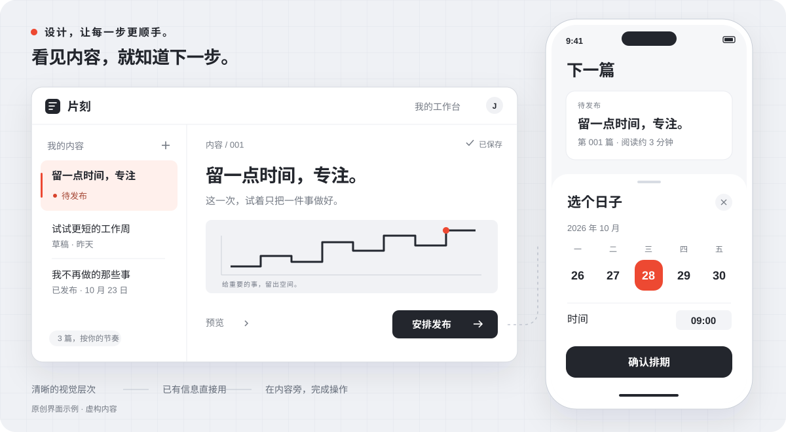

<p align="center">
  <picture>
    <source media="(prefers-color-scheme: dark)" srcset="docs/assets/wordmark-dark.svg" />
    
  </picture>
</p>

<h3 align="center">让你的编程 Agent，兼任设计负责人。</h3>

<p align="center">为没有专职设计师的独立开发者与小团队而做。</p>

<p align="center">
  <a href="#start"><strong>开始使用</strong></a> &nbsp;&nbsp;
  <a href="docs/installation.zh-CN.md">选择你的 Agent</a> &nbsp;&nbsp;
  <a href="benchmarks/README.md">公开对照测试</a> &nbsp;&nbsp;
  <a href="README.md">English</a>
</p>

<p align="center">
  <picture>
    <source media="(max-width: 600px)" srcset="docs/assets/interface-study-mobile.zh-CN.svg" />
    
  </picture>
  <br/>
  <sub>原创界面示例 · 虚构内容 · 用于展示设计思路，非已上线 App。</sub>
</p>

**你不必先学会设计，才能做出一个好产品。**

UI Foundry 让编程 Agent 兼任产品设计师：从想法或现有页面出发，选择视觉方向、设计交互、实现并检查主要任务。它提供**视觉底稿、可运行范例、组件适配与审核返修**；你负责产品目标和必要约束。

<p align="center">
  <strong>网页 · 产品工作台 · 原生 App</strong><br/>
  <sub>公开测试版 · MIT · Skill 无需额外服务或 API key</sub>
</p>

<a id="start"></a>

## 安装一次，从你的想法开始

```sh
npx skills add theosunny/ui-foundry -g
```

在安装器里选择 **Codex、Claude Code、Cursor、OpenCode 或 OpenClaw**，然后直接说：

> 用 UI Foundry 把这个产品做好看、做顺手。设计细节你来定，让主要任务更省力，做完检查实际效果，保留已有的好用功能。

一个想法、一张现有页面、一个仓库，或一份草图，都能作为起点。

<details>
<summary>安装要求、其他方式与调用方法</summary>

[Skills CLI](https://github.com/vercel-labs/skills) 需要 **Node.js 22.20+**。`-g` 表示跨项目使用；去掉它，只安装到当前项目。Skill 本身无需配置 Node.js 或 Python。

Codex 中可用 **`$ui-foundry`** 明确调用。其他客户端使用各自的 Skill 选择器或调用格式；按客户端要求重新加载。

[指定客户端与手动安装](docs/installation.zh-CN.md) · [ClawHub](https://clawhub.ai/theosunny/skills/ui-foundry) · [下载 ZIP](https://github.com/theosunny/ui-foundry/releases)

ClawHub 与 GitHub 版本可能不同；最新实际验证状态见[安装记录](docs/installation-validation.md)。

</details>

## 把功夫花在这些细节上

| 视觉有整体感 | 用起来更省力 | 做完，真的检查 |
| --- | --- | --- |
| 构图、字体、层次和状态一起设计。App 按移动端的习惯来做。 | 已有信息直接用，操作放在内容旁，需要时才让用户补充。 | 看实际页面，走真实任务。发现问题就修，再核对结果。 |

内置可直接采用的排版、间距、浅深色 token 和可运行范例。Agent 按任务选用并调整，沿用项目已认可的视觉方向，接上兼容的组件。你不必自己选库、配色或拼提示词。[查看完整体系](docs/design-system.md)。

**常用交互也是设计的一部分。** 日期、搜索、地点、选择、上传、导航和反馈，按 Web、iOS、Android 匹配合适控件。包内提供可运行的 Web 交互起点、服务端地点搜索适配和 SwiftUI 范例；由 Agent 完成数据接线、取消、错误恢复和有目的的动效。[组件能力与验证范围](docs/component-kit.md)。

未列出的场景也有统一标准：高频能力可以直接复用，特殊任务由 Agent 在数据、平台、状态和验收约束下设计。固定质量要求，保留设计创造力。

现有代码包含日程与地点选择，以及[内容收藏示例](skills/ui-foundry/assets/collection-reference.html)的搜索、筛选、编辑、保存和撤销。上传、看板、支付等更多场景目前主要是选型与验收标准，不应当成已内置完整实现。[查看能力与验证范围](docs/capabilities.md)。

## 你在哪一步，就从哪一步开始

| 手上有什么 | 直接这样说 |
| --- | --- |
| **一个想法** | “设计并实现这个 iPhone App，方向你来定。” |
| **一个难用的页面** | “这里让我读太多、填太多，把任务做得更顺手。” |
| **要交给其他 Agent 的需求** | “把想法整理成完整设计任务书，先不改代码。” |
| **一个不满意的结果** | “找出这次设计失败的原因，修正后再检查。” |

流程很简单：**理解任务 → 设计 → 实现 → 检查 → 改进**。检查时分清已验证、明确有问题和缺少证据；能构建成功，只是其中一步。

## 效果，拿证据来说

同一任务，对比加载和不加载 Skill 的结果：两组产物都公开，检查实际保存的数据，再匿名评审界面。失败保留，修复另开一轮并复测反例。首轮样本很小，不足以证明稳定领先。

[四组实验](docs/factorial-evaluation.md)现已实际生成两个领域的基准、规则、示例、组合产物。基准、示例和组合的行为检查持平；仅规则组有两项窄屏失败。示例按任务机制迁移，不以行业作白名单；现有结果不支持宣传“稳定更好”。

后续[首轮构图实验](docs/first-render-evaluation.md)检验了生成前的具体构图预检。两个新任务上，两位匿名审核者在反转展示顺序后仍更偏好新版首稿；文案与控件仍有缺陷。这是局部正向证据，不是质量保证。

[对照方法与结果](benchmarks/README.md) · [开源验收](docs/open-source-readiness.md) · [宣传与证据](docs/claims.md)

## Skill 里有什么

视觉配方、CSS 底稿、可运行范例、组件适配与审核工具随包提供。可选脚本位于已安装 Skill 的 `ui-foundry/scripts/check_design_gate.py`，由 Agent 定位，**你不需要手动运行 Python**。它检查记录格式，不认证审美或证据真假。

[查看 Skill](skills/ui-foundry/SKILL.md) · [审核方法](skills/ui-foundry/references/review.md) · [进阶脚本说明](docs/review-records.md#中文)

<details>
<summary>语言、验证范围与隐私</summary>

README 提供中英文版本。Skill 内部指令目前使用中文，你可以要求 Agent 用偏好的语言输出。

安装成功不代表每个客户端行为相同，浏览器检查也不能代替原生 App 验收。[行为验证](docs/validation.md)与[安装验证](docs/installation-validation.md)分别记录实际范围。上方界面是原创示意，不是实测的前后对比成果。

UI Foundry 提供设计基础及实现、审核流程，不能保证每次产出都完美。公开包不含私人偏好、聊天记录、凭据或真实用户资料，也不会自动上传项目数据或发布自身更新。

</details>

## 一起把它做好

发现问题可以[提交 Issue](https://github.com/theosunny/ui-foundry/issues)，附上虚构或脱敏案例：你的要求、预期结果、实际结果和客户端。有用的反馈，会帮助改进这套方法。

[参与贡献](CONTRIBUTING.md) · [安全报告](SECURITY.md) · [MIT 许可](LICENSE) · [版本记录](CHANGELOG.md) · [参考致谢](ACKNOWLEDGMENTS.md)
