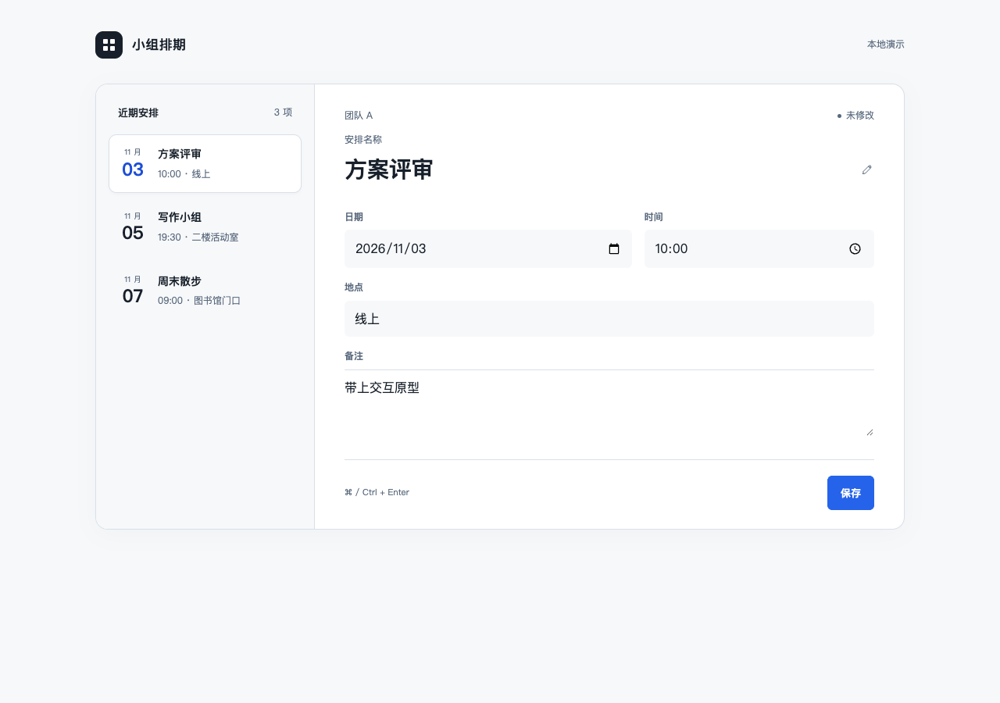

# Results · 2026-10-27

**Verdict: useful foundations and a working repair loop; not evidence of reliably superior design.** This is a small public beta study. Exact outputs, failures, screenshots, manifests and runners are retained. No private profile was supplied to the generation arms.

| Attempt | Observation | Conclusion |
| --- | --- | --- |
| Initial schedule A / B | Both 8/9 browser checks; both reseed a valid stored empty list | Tie on measured behavior, both require repair |
| Initial visual review | Anonymous reviewer prefers B, but identifies repeated information and poor mobile density | Local preference only; preferred output still needs work |
| Initial iPhone brief | Anonymous reviewer prefers B's focus; B loses an allowed date source and defaults unknown to confirmed absence | Rework, no native runtime claim |
| Schedule contract repair | B 9/9; nonempty unknown fields and empty list both preserved | Original failure fixed in tested cases |
| Concrete-foundation generation | 9/9 behavior checks, but duplicated summary pushes mobile editing below fold | Functional success does not pass visual/interaction review |
| Authored reference, reviewed revision | 9/9; title editable once, all three choices and Save visible on 390×844 | Independent static review passes within its scope; not a new blind-generation win |
| CSS primitives | Initially 4/6; corrected contrast and checkbox styling yield 6/6 | Observed component defects fixed; not full WCAG certification |
| Fresh reading task | Corrected harness: 8/9; only the recommendation could be opened | Failed transfer is retained, not hidden |
| Reading repair | 9/9; direct links, persistent read state, exact Undo, empty state, no forced typing | Concrete defect fixed; now a regression case, not held-out evidence |
| HeroUI adapter | Build plus 3/3 Chrome checks on genuine locked components | Tested integration, not proof every HeroUI product is good |
| Existing-brand counterexample | Brief keeps charcoal/red brand, React 18/Tailwind 3/shadcn; selects public introduction rather than workspace | Routing preserved; document-only, not rendered evidence |
| 0.2.0 component release | Actual 31-file ZIP: 22 browser checks; server adapter 7 mocked groups; iOS 17 typecheck and 12 civil-date checks | Integration/regression evidence, not a new blind generation win; no live map or native runtime claim |
| 0.3.0 development collection | Initial mobile reference passed behavior but had repetitive oversized cards; revised list passed 6 browser groups, including exact undo and persistence | Authored regression example; visual preference, independent review and transfer remain unverified |
| iOS reference render | Existing SwiftUI editor compiled and displayed in an iOS 27 simulator host | Static initial frame only, no native interaction or high-quality design claim |
| Four-arm pilot | 2 tasks × 4 arms; baseline 10/10, rules 8/10, examples 10/10, combination 10/10 | No measured behavioral advantage for the combination; initial failures, sources and harness corrections retained. See [experiment](../docs/factorial-evaluation.md) |
| Composition preflight probe | Full Skill before/after on 2 new task families; before 7/8 behavior checks, after 8/8; two anonymous AI reviewers prefer after on both tasks, with reversed display order | Limited positive evidence; unsupported copy and weak selector affordances remain. No stable superiority claim. See [evaluation](../docs/first-render-evaluation.md) |

## Inspect the work

- [Initial paired manifest and exact Skill snapshot](runs/2026-10-27/pilot/manifest.json), [A](runs/2026-10-27/pilot/A/), [B](runs/2026-10-27/pilot/B/)
- [Initial visual review](runs/2026-10-27/pilot/visual-blind-review.md), [brief review](runs/2026-10-27/pilot/brief-blind-review.md), [reviewer omissions and mapping](runs/2026-10-27/pilot/brief-review-mapping.json)
- [Contract repair](runs/2026-10-27/repair/B/), [foundation failure and repair record](runs/2026-10-27/foundation/review.md), [final reference results](runs/2026-10-27/foundation/final/B/schedule/observation.json)
- [CSS initial failure](runs/2026-10-27/foundation/primitives/observation.json), [CSS repair](runs/2026-10-27/foundation/primitives/repair/observation.json)
- [Reading forward-check manifest](runs/2026-10-27/transfer/manifest.json), [initial artifact](runs/2026-10-27/transfer/reading/), [repair](runs/2026-10-27/repair/reading/)
- [HeroUI fixture, versions and build observations](integrations/heroui/report.md), [browser results](integrations/heroui/result.json)
- [Counterexample request, criteria and brief](runs/2026-10-27/counterexample/): existing brand and incompatible stack remain intact; known trial terms remain beside the CTA. The brief's unconfirmed input workflow is provisional, not an established product capability.
- [Component failures and repairs](../docs/component-kit-verification.md), [initial observations](runs/2026-10-27/components/initial/), [final component evidence](runs/2026-10-27/components/final/): actual calendar and combobox operation, persistence, stale searches, failure recovery and IME checks. Independent screenshot review was scoped to visible states.
- [Collection reference, initial and revision](runs/2026-10-30/collection/review.md) · [iOS simulator frame](runs/2026-10-30/ios-reference/README.md). These are development artifacts, not independent generation trials.

### Real reference, after repair

The [runnable source](../skills/ui-foundry/assets/workspace-reference.html) and its CSS travel with the Skill. This is a fictional local scheduling example, not a claim that a customer's product is finished.

## What changed in the Skill

1. Process-only advice left too much to improvisation. The package now carries concrete visual recipes, original CSS, a runnable reference and stack adapters; the entrypoint routes the agent through them.
2. A task inside an app is not a marketing page just because it involves reading. The routing now separates object-based product work from public editorial/marketing surfaces.
3. Preserving data requires a non-default stored-state check. Unknown, absent and explicitly empty are distinct; allowed information sources and a minimal completion/undo path must remain intact.
4. Automated and independent reviews can be wrong. The reading runner initially overwrote fixtures on reload and falsely blamed persistence. That result is preserved as `observation-harness-bug.json`; the [correction](runs/2026-10-27/transfer/reading/HARNESS-CORRECTION.md) fixes the test premise and reruns the unchanged product. The missing article links were a separate real defect.

## Limits

One platform/model environment, one initial attempt per arm; exact resolved model ID, temperature, cost and generation time were not exposed. The two pilot tasks shared a context per arm; later transfer used one task in a fresh context. Anonymous reviews were performed by AI, not a panel of human designers. No native app was built, no real users were tested, and no competitive benchmark against Lovable, Impeccable or another Skill was run. HeroUI's build emitted non-fatal module-directive warnings, recorded in its fixture report.

The evidence supports the named checks and repairs. It does not support “award-winning,” “perfect UI,” a universal win rate, cost savings or equivalent quality across all clients. Next useful evidence: repeated preregistered tasks with independent human review and native execution—not more self-assigned scores.

## 中文结论

这轮确实发现并修复了不合格项，包括 Skill 的默认设计基础不足、错误的信息来源限制、重复信息造成的移动布局问题，以及组件样式缺陷。也纠正了一次测试误报。失败和修订都公开，工程检查与视觉评审分开。

目前可发布为公开测试版。还不能把小样本、维护者亲自修好的范例，宣传成“任意模型开箱必然获奖”。
